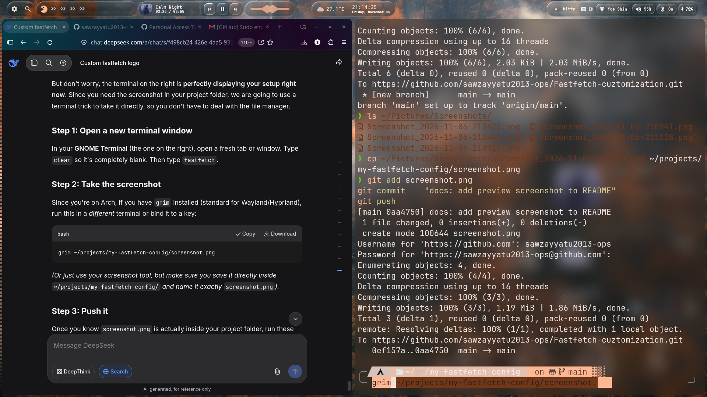

<div align="center">

# 🐧 Modular Arch Fastfetch

**A clean, customized, and modular Fastfetch configuration for Arch Linux.**

[](https://archlinux.org/)
[](https://github.com/fastfetch-cli/fastfetch)
[](#license)

</div>

---

## 📸 Preview

<div align="center">
  
</div>

---

## ✨ Features

- **Custom ASCII Logo:** A dual-logo design featuring Tux (Linux) and the Arch Linux logo side-by-side.
- **Modular Design:** System info is grouped into clean, colored, custom-drawn boxes (`System`, `Desktop`, `Hardware`).
- **Truecolor Support:** Beautiful Arch Blue borders and vibrant yellow/blue logo colors.
- **Zero Dependencies:** Uses standard ASCII and ANSI escape codes. No special fonts or libraries required (though a Nerd Font is recommended for the icons).
- **Safe Installer:** Automatically backs up your existing `config.jsonc` and `my-logo.txt` before applying the new ones.

---

## 🚀 Installation

### Prerequisites

You need `fastfetch` installed on your system. 
If you are on Arch Linux:
```bash
sudo pacman -S fastfetch
Copy and paste this entire block into your terminal. It will download the files to a temporary folder, back up your current config, install the new one, and clean up after itself.
bash

### How to install
```bash
git clone https://github.com/sawzayyatu2013-ops/Fastfetch-cuztomization.git /tmp/ff-config && cd /tmp/ff-config && chmod +x install.sh && ./install.sh && cd ~ && rm -rf /tmp/ff-config

The Manual Way

If you prefer to install it manually:
```bash
    Clone the repository:
    Copy and paste this into your terminal:
    bash

    git clone https://github.com/sawzayyatu2013-ops/Fastfetch-cuztomization.git

